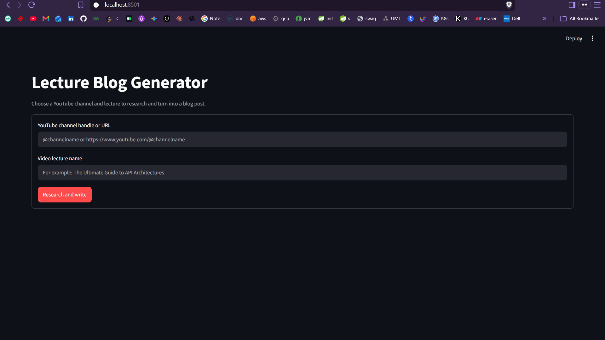
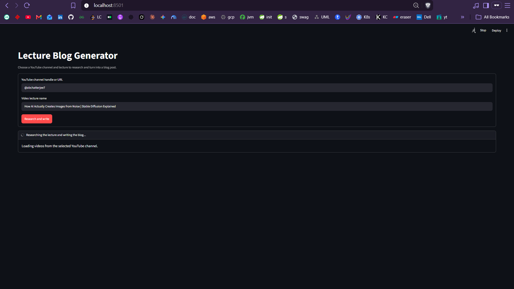
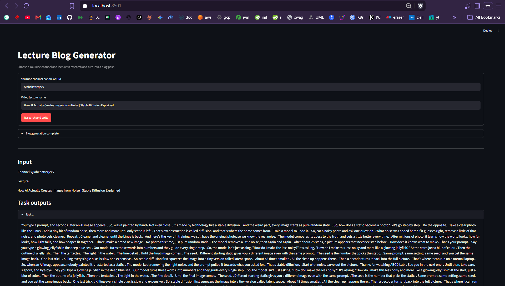

# YouTube Blog Generator with CrewAI

A small CrewAI multi-agent project that researches videos from a YouTube channel and turns a selected lecture name into a Markdown blog post. Enter the channel handle or URL and lecture name in Streamlit. The app displays the submitted input, research result, and final blog. The agents use Groq for text generation.

> **Current behavior:** search a YouTube channel by lecture name, or provide a YouTube video URL to retrieve that video's transcript directly. Enter a channel `@handle`, channel ID, or supported YouTube channel URL, not just its display name.

## How It Works

The crew runs two agents sequentially:


1. **Blog researcher** uses the YouTube channel search tool to find information for the requested topic and prepares a short research report.
2. **Blog writer** uses the research result to draft a readable blog post.
3. Streamlit displays the research and final blog, with an option to download the blog as Markdown.

YouTube search embeddings use Chroma's local ONNX model. Each selected channel gets a separate vector collection; `GROQ_API_KEY` and `GROQ_MODEL_NAME` configure text generation.

## Run on Windows

Open PowerShell in the project folder. Create and activate the virtual environment if you do not already have one:

```powershell
py -3.12 -m venv venv
.\venv\Scripts\Activate.ps1
```

Install dependencies:

```powershell
python -m pip install --upgrade pip
python -m pip install -r requirements.txt
```

Create `.env` from `.env.example` only if `.env` does not already exist, then set your Groq API key and model:

```dotenv
GROQ_API_KEY=your_groq_api_key
GROQ_MODEL_NAME=openai/gpt-oss-120b
```

Keep your real key private. `.env` is ignored by Git; do not commit it or paste the key into source code. Set `GROQ_MODEL_NAME` to a model ID available to your Groq account. The app adds the `groq/` LiteLLM provider prefix automatically.

Launch Streamlit from the project folder:

```bash
python -m streamlit run app.py
```

Open the Local URL printed by Streamlit (usually `http://localhost:8501`). Enter a YouTube channel handle or URL and a lecture name. When you have a specific video URL, provide it to search that video's transcript directly. The app displays each task's output and the final blog.

- How the UI page look when opens up


- When you feed the blanks and the app is processing...


- When app generates blog content from youtube video


## Customize the Run

- **YouTube channel:** enter a channel `@handle`, channel ID, or supported channel URL in the Streamlit form.
- **Model:** set `GROQ_MODEL_NAME` in `.env` to a model ID available to your Groq account, such as `openai/gpt-oss-120b`.

The channel handle identifies the channel, while an optional video URL lets the app retrieve the exact lecture transcript directly. A display name by itself is not enough to identify a channel reliably.

## Project Structure

| File | Purpose |
| --- | --- |
| `agents.py` | Defines the researcher and writer agents and their Groq LLM. |
| `tasks.py` | Builds the research and writing tasks for each run. |
| `tools.py` | Configures channel search and local ONNX embeddings. |
| `crew.py` | Creates and runs the sequential crew for a topic. |
| `app.py` | Streamlit UI for lecture input, task output, and blog display. |
| `requirements.txt` | Python dependencies installed into `venv`. |
| `.env.example` | Template for Groq configuration; copy to `.env`. |


## Security
Never commit `.env` or expose your Groq API key in logs, screenshots, source code, or public issue reports. If a key is exposed, revoke it and create a replacement.